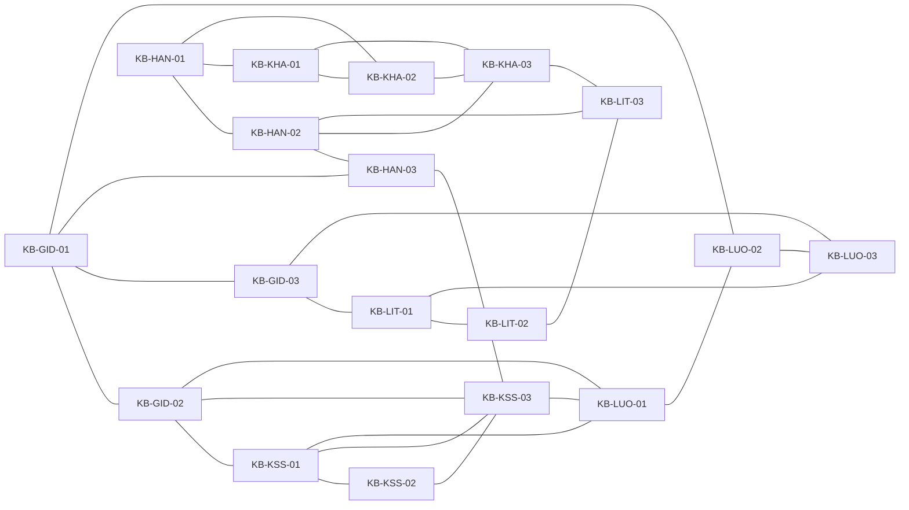

# Knowledge graph

The graph connects mechanisms, exact results, transfer boundaries, and lifetime/control relationships.

## Adjacency list

- **KB-GID-01:** [KB-GID-02](nodes/carry-venting-identity.md), [KB-GID-03](nodes/outer-control-at-zero-toffoli.md), [KB-LUO-02](nodes/gidney-modular-adder-costs.md), [KB-HAN-03](nodes/producer-consumer-and-workspace-reuse.md)
- **KB-GID-02:** [KB-GID-01](nodes/workspace-toffoli-tradeoffs.md), [KB-LUO-01](nodes/one-bit-mbu-branches.md), [KB-KSS-01](nodes/ghosting-transformation.md), [KB-KSS-03](nodes/live-classical-memory.md)
- **KB-GID-03:** [KB-GID-01](nodes/workspace-toffoli-tradeoffs.md), [KB-LUO-03](nodes/external-control-scope.md), [KB-LIT-01](nodes/controlled-add-subtract.md)
- **KB-HAN-01:** [KB-HAN-02](nodes/fixed-rounds-and-pseudoinverse-correction.md), [KB-KHA-01](nodes/explicit-vs-implicit-bezout.md), [KB-KHA-02](nodes/direct-division-by-dialog-replay.md)
- **KB-HAN-02:** [KB-HAN-01](nodes/normalized-kaliski-round.md), [KB-HAN-03](nodes/producer-consumer-and-workspace-reuse.md), [KB-LIT-03](nodes/prime-field-interface-limit.md), [KB-KHA-03](nodes/dialog-and-prime-field-transfer-limit.md)
- **KB-HAN-03:** [KB-HAN-02](nodes/fixed-rounds-and-pseudoinverse-correction.md), [KB-GID-01](nodes/workspace-toffoli-tradeoffs.md), [KB-KSS-03](nodes/live-classical-memory.md)
- **KB-KHA-01:** [KB-KHA-02](nodes/direct-division-by-dialog-replay.md), [KB-KHA-03](nodes/dialog-and-prime-field-transfer-limit.md), [KB-HAN-01](nodes/normalized-kaliski-round.md)
- **KB-KHA-02:** [KB-KHA-01](nodes/explicit-vs-implicit-bezout.md), [KB-KHA-03](nodes/dialog-and-prime-field-transfer-limit.md), [KB-HAN-01](nodes/normalized-kaliski-round.md)
- **KB-KHA-03:** [KB-KHA-01](nodes/explicit-vs-implicit-bezout.md), [KB-KHA-02](nodes/direct-division-by-dialog-replay.md), [KB-LIT-03](nodes/prime-field-interface-limit.md), [KB-HAN-02](nodes/fixed-rounds-and-pseudoinverse-correction.md)
- **KB-KSS-01:** [KB-KSS-02](nodes/spooky-pebble-binomial-bound.md), [KB-KSS-03](nodes/live-classical-memory.md), [KB-LUO-01](nodes/one-bit-mbu-branches.md), [KB-GID-02](nodes/carry-venting-identity.md)
- **KB-KSS-02:** [KB-KSS-01](nodes/ghosting-transformation.md), [KB-KSS-03](nodes/live-classical-memory.md)
- **KB-KSS-03:** [KB-KSS-01](nodes/ghosting-transformation.md), [KB-KSS-02](nodes/spooky-pebble-binomial-bound.md), [KB-LUO-01](nodes/one-bit-mbu-branches.md), [KB-GID-02](nodes/carry-venting-identity.md)
- **KB-LIT-01:** [KB-LIT-02](nodes/intermediate-expression-and-cost.md), [KB-LUO-03](nodes/external-control-scope.md), [KB-GID-03](nodes/outer-control-at-zero-toffoli.md)
- **KB-LIT-02:** [KB-LIT-01](nodes/controlled-add-subtract.md), [KB-LIT-03](nodes/prime-field-interface-limit.md)
- **KB-LIT-03:** [KB-LIT-02](nodes/intermediate-expression-and-cost.md), [KB-KHA-03](nodes/dialog-and-prime-field-transfer-limit.md), [KB-HAN-02](nodes/fixed-rounds-and-pseudoinverse-correction.md)
- **KB-LUO-01:** [KB-LUO-02](nodes/gidney-modular-adder-costs.md), [KB-GID-02](nodes/carry-venting-identity.md), [KB-KSS-01](nodes/ghosting-transformation.md), [KB-KSS-03](nodes/live-classical-memory.md)
- **KB-LUO-02:** [KB-LUO-01](nodes/one-bit-mbu-branches.md), [KB-LUO-03](nodes/external-control-scope.md), [KB-GID-01](nodes/workspace-toffoli-tradeoffs.md)
- **KB-LUO-03:** [KB-LUO-02](nodes/gidney-modular-adder-costs.md), [KB-LIT-01](nodes/controlled-add-subtract.md), [KB-GID-03](nodes/outer-control-at-zero-toffoli.md)

## Concept hubs

- [Representation and interface contracts](concepts/representation-and-interface-contracts.md)
- [Measurement uncomputation and phase debt](concepts/measurement-uncomputation-and-phase-debt.md)
- [Control locality](concepts/control-locality-and-controlled-arithmetic.md)
- [EEA representations and schedules](concepts/eea-representations-and-inversion.md)
- [Time-space and cost models](concepts/time-space-and-cost-models.md)
- [Producer-consumer lifetime optimization](concepts/producer-consumer-and-lifetime-optimization.md)
