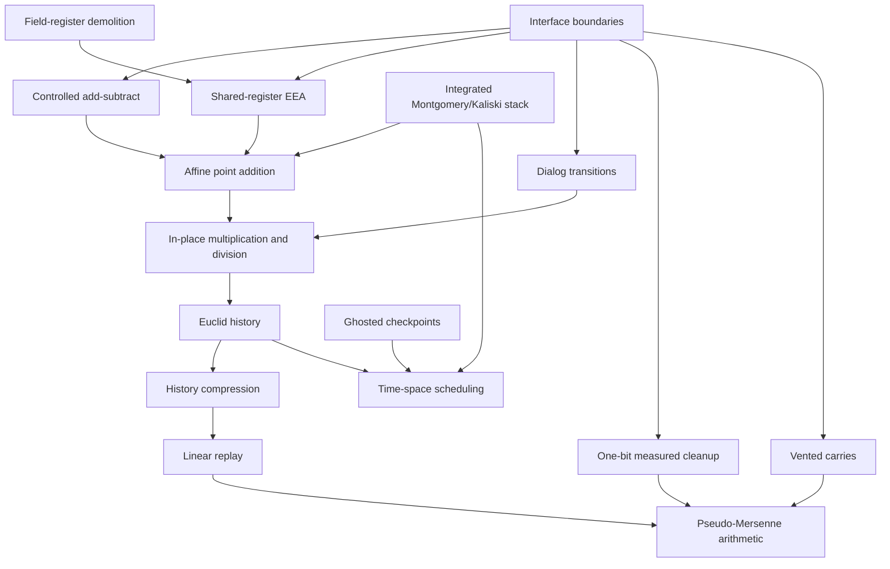

# Knowledge graph

## Main routes

- Point-addition route:
  [`concepts/point-addition.md`](concepts/point-addition.md)
- Representation route:
  [`concepts/history-and-bezout-representations.md`](concepts/history-and-bezout-representations.md)
- Measurement route:
  [`concepts/measurement-assisted-uncomputation.md`](concepts/measurement-assisted-uncomputation.md)
- Scheduling route:
  [`concepts/time-space-scheduling.md`](concepts/time-space-scheduling.md)
- Compatibility route:
  [`concepts/paper-interface-boundaries.md`](concepts/paper-interface-boundaries.md)
